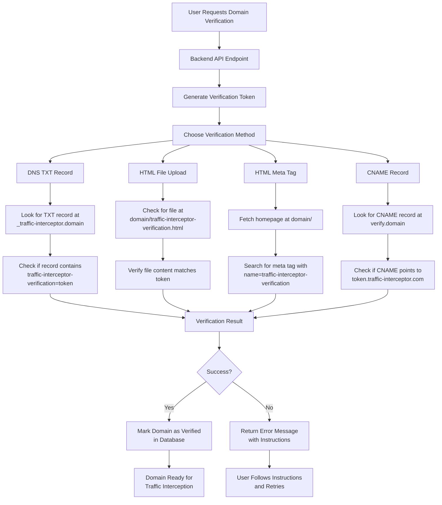

# Domain Verification System Documentation

## Overview

The Traffic Interceptor platform implements a robust **multi-method domain verification system** to ensure only legitimate domain owners can set up traffic interception. This system provides multiple verification methods and comprehensive validation processes.

## Architecture



## Verification Methods

### 1. DNS TXT Record Verification

**Most Recommended Method**

- **Record Type**: TXT
- **Record Name**: `_traffic-interceptor.yourdomain.com`
- **Record Value**: `traffic-interceptor-verification=TOKEN`
- **TTL**: 300 seconds (5 minutes)

**Steps:**
1. Log in to your DNS provider (Cloudflare, Route53, etc.)
2. Add a TXT record for: `_traffic-interceptor.yourdomain.com`
3. Set the value to: `traffic-interceptor-verification=TOKEN`
4. Save the record and wait for DNS propagation (up to 24 hours)
5. Click "Verify" to complete the process

**Example:**
```bash
# DNS Record
Name: _traffic-interceptor.example.com
Type: TXT
Value: traffic-interceptor-verification=a1b2c3d4e5f6g7h8i9j0k1l2m3n4o5p6
TTL: 300
```

### 2. HTML File Upload Verification

**Alternative Method**

- **File Name**: `traffic-interceptor-verification.html`
- **File Location**: `https://yourdomain.com/traffic-interceptor-verification.html`
- **File Content**: `TOKEN` (plain text)

**Steps:**
1. Create a file named: `traffic-interceptor-verification.html`
2. Add this content to the file: `TOKEN`
3. Upload the file to: `http(s)://yourdomain.com/traffic-interceptor-verification.html`
4. Ensure the file is publicly accessible
5. Click "Verify" to complete the process

**Example:**
```html
<!-- File: traffic-interceptor-verification.html -->
a1b2c3d4e5f6g7h8i9j0k1l2m3n4o5p6
```

### 3. HTML Meta Tag Verification

**Web Developer Friendly**

- **Tag Name**: `traffic-interceptor-verification`
- **Tag Location**: `<head>` section of homepage
- **Tag Content**: `TOKEN`

**Steps:**
1. Add meta tag to the `<head>` section of your homepage
2. Save and publish your changes
3. Ensure the tag is visible at: `http(s)://yourdomain.com/`
4. Click "Verify" to complete the process

**Example:**
```html
<!DOCTYPE html>
<html>
<head>
    <meta name="traffic-interceptor-verification" content="a1b2c3d4e5f6g7h8i9j0k1l2m3n4o5p6" />
    <!-- Other head content -->
</head>
<body>
    <!-- Page content -->
</body>
</html>
```

### 4. CNAME Record Verification

**Fast Propagation Method**

- **Record Type**: CNAME
- **Record Name**: `verify.yourdomain.com`
- **Record Target**: `TOKEN.traffic-interceptor.com`

**Steps:**
1. Log in to your DNS provider
2. Add a CNAME record for: `verify.yourdomain.com`
3. Point it to: `TOKEN.traffic-interceptor.com`
4. Save the record and wait for DNS propagation
5. Click "Verify" to complete the process

**Example:**
```bash
# CNAME Record
Name: verify.example.com
Type: CNAME
Target: a1b2c3d4e5f6g7h8i9j0k1l2m3n4o5p6.traffic-interceptor.com
TTL: 300
```

## API Endpoints

### Create Domain
```http
POST /api/v1/domains
Authorization: Bearer {JWT_TOKEN}
Content-Type: application/json

{
  "domain_name": "example.com",
  "ssl_enabled": false,
  "cdn_enabled": false,
  "verification_method": "dns"
}
```

**Response:**
```json
{
  "message": "Domain created successfully",
  "domain": {
    "id": 1,
    "uuid": "123e4567-e89b-12d3-a456-426614174000",
    "domain_name": "example.com",
    "is_verified": false,
    "status": "pending",
    "verification_method": "dns",
    "verification_token": "a1b2c3d4e5f6g7h8i9j0k1l2m3n4o5p6",
    "created_at": "2025-08-26T12:00:00Z"
  }
}
```

### Verify Domain
```http
POST /api/v1/domains/{domain_id}/verify
Authorization: Bearer {JWT_TOKEN}
Content-Type: application/json

{
  "method": "dns"
}
```

**Response (Success):**
```json
{
  "message": "Domain verified successfully",
  "domain": {
    "id": 1,
    "domain_name": "example.com",
    "is_verified": true,
    "status": "verified",
    "verification_method": "dns",
    "updated_at": "2025-08-26T12:30:00Z"
  }
}
```

**Response (Failed):**
```json
{
  "success": false,
  "error": "DNS TXT record not found or token mismatch",
  "expected": "traffic-interceptor-verification=a1b2c3d4e5f6g7h8i9j0k1l2m3n4o5p6",
  "instruction": "Add TXT record to _traffic-interceptor.example.com"
}
```

### Get Verification Instructions
```http
GET /api/v1/domains/{domain_id}/verification-instructions
Authorization: Bearer {JWT_TOKEN}
```

**Response:**
```json
{
  "domain": "example.com",
  "token": "a1b2c3d4e5f6g7h8i9j0k1l2m3n4o5p6",
  "methods": {
    "dns": {
      "title": "DNS TXT Record Verification",
      "steps": [
        "Log in to your DNS provider (e.g., Cloudflare, Route53, etc.)",
        "Add a TXT record for: _traffic-interceptor.example.com",
        "Set the value to: traffic-interceptor-verification=a1b2c3d4e5f6g7h8i9j0k1l2m3n4o5p6",
        "Save the record and wait for DNS propagation (up to 24 hours)",
        "Click 'Verify' to complete the process"
      ],
      "note": "DNS changes may take up to 24 hours to propagate worldwide"
    }
  }
}
```

## Database Schema

### Domains Table
```sql
CREATE TABLE domains (
    id SERIAL PRIMARY KEY,
    uuid VARCHAR(36) UNIQUE NOT NULL,
    domain_name VARCHAR(255) NOT NULL,
    tenant_id INTEGER REFERENCES tenants(id),
    
    -- Verification fields
    is_verified BOOLEAN DEFAULT FALSE,
    verification_token VARCHAR(255),
    verification_method VARCHAR(50) DEFAULT 'dns',
    verification_attempts INTEGER DEFAULT 0,
    last_verification_attempt TIMESTAMP,
    verified_at TIMESTAMP,
    
    -- SSL & Security
    ssl_enabled BOOLEAN DEFAULT FALSE,
    ssl_certificate JSONB,
    ssl_expires_at TIMESTAMP,
    
    -- Configuration
    status VARCHAR(20) DEFAULT 'pending',
    traffic_enabled BOOLEAN DEFAULT TRUE,
    cdn_enabled BOOLEAN DEFAULT FALSE,
    
    -- Timestamps
    created_at TIMESTAMP DEFAULT NOW(),
    updated_at TIMESTAMP DEFAULT NOW()
);
```

### Indexes
```sql
CREATE INDEX idx_domains_verification ON domains(is_verified, verification_method);
CREATE INDEX idx_domains_status ON domains(status);
CREATE INDEX idx_domains_tenant ON domains(tenant_id);
```

## Security Features

### Token Generation
- **Algorithm**: SHA-256 hash
- **Components**: Domain name + timestamp + random hex
- **Length**: 32 characters
- **Uniqueness**: Guaranteed per domain per attempt

### Verification Timeout
- **DNS Queries**: 10 seconds timeout
- **HTTP Requests**: 10 seconds timeout
- **Max Retries**: 3 attempts
- **Rate Limiting**: 5 verification attempts per hour per domain

### SSL Certificate Validation
```python
def check_domain_ssl(self, domain: str) -> Dict:
    """
    - Validates SSL certificate
    - Checks expiration date
    - Verifies certificate chain
    - Returns issuer information
    """
```

### Domain Access Validation
```python
def validate_domain_access(self, domain: str) -> Dict:
    """
    - Tests HTTP/HTTPS accessibility
    - Measures response times
    - Checks for redirects
    - Validates SSL if available
    """
```

## Implementation Files

### Core Service
- **File**: `app/interceptor/domain_verification_enhanced.py`
- **Class**: `DomainVerificationService`
- **Methods**: 
  - `verify_domain_ownership()`
  - `generate_verification_token()`
  - `get_verification_instructions()`

### API Endpoints
- **File**: `app/api/phase2_endpoints.py`
- **Routes**:
  - `POST /api/v1/domains`
  - `POST /api/v1/domains/{id}/verify`
  - `GET /api/v1/domains/{id}/verification-instructions`

### Legacy Implementation
- **File**: `app/interceptor/domain_verification.py`
- **Features**: Async verification, bot detection integration

## Error Handling

### Common Errors

| Error Code | Description | Solution |
|------------|-------------|----------|
| `DNS_NOT_FOUND` | Domain not found in DNS | Check domain spelling, wait for propagation |
| `TXT_RECORD_MISSING` | TXT record not found | Add the required TXT record |
| `TOKEN_MISMATCH` | Verification token doesn't match | Copy the exact token provided |
| `FILE_NOT_ACCESSIBLE` | HTML file not reachable | Ensure file is uploaded and publicly accessible |
| `META_TAG_MISSING` | Meta tag not found on homepage | Add meta tag to `<head>` section |
| `SSL_ERROR` | SSL certificate issues | Check certificate validity |
| `TIMEOUT_ERROR` | Request timed out | Check domain accessibility |

### Retry Logic
```python
# Automatic retry with exponential backoff
max_retries = 3
retry_delay = [1, 2, 4]  # seconds

for attempt in range(max_retries):
    try:
        result = verify_method(domain, token)
        if result['success']:
            break
    except Exception as e:
        if attempt < max_retries - 1:
            time.sleep(retry_delay[attempt])
        else:
            raise e
```

## Usage Examples

### Frontend Integration
```javascript
// Create domain
const createDomain = async (domainName) => {
  const response = await fetch('/api/v1/domains', {
    method: 'POST',
    headers: {
      'Authorization': `Bearer ${token}`,
      'Content-Type': 'application/json'
    },
    body: JSON.stringify({
      domain_name: domainName,
      verification_method: 'dns'
    })
  });
  return response.json();
};

// Verify domain
const verifyDomain = async (domainId, method = 'dns') => {
  const response = await fetch(`/api/v1/domains/${domainId}/verify`, {
    method: 'POST',
    headers: {
      'Authorization': `Bearer ${token}`,
      'Content-Type': 'application/json'
    },
    body: JSON.stringify({ method })
  });
  return response.json();
};
```

### Python CLI Usage
```python
from app.interceptor.domain_verification_enhanced import domain_verification_service

# Generate token
token = domain_verification_service.generate_verification_token('example.com')

# Verify domain
result = domain_verification_service.verify_domain_ownership(
    domain='example.com',
    method='dns',
    token=token
)

if result['success']:
    print(f"✅ Domain verified: {result['message']}")
else:
    print(f"❌ Verification failed: {result['error']}")
    print(f"📝 Instructions: {result.get('instruction', '')}")
```

## Best Practices

### For Developers
1. **Always validate domain format** before verification
2. **Implement proper error handling** with user-friendly messages
3. **Use async verification** for better user experience
4. **Cache verification results** to avoid repeated checks
5. **Monitor verification success rates** for system health

### For Users
1. **Use DNS verification** when possible (most reliable)
2. **Wait for DNS propagation** (up to 24 hours)
3. **Test verification token** before submitting
4. **Keep verification files** accessible during verification
5. **Remove verification artifacts** after successful verification

### Security Considerations
1. **Token expiration**: Tokens should expire after 7 days
2. **Rate limiting**: Limit verification attempts per domain
3. **Input validation**: Sanitize all domain inputs
4. **SSL enforcement**: Prefer HTTPS for all verifications
5. **Audit logging**: Log all verification attempts

## Monitoring & Analytics

### Metrics to Track
- **Verification success rate** by method
- **Average verification time** per method
- **Most common verification errors**
- **DNS propagation times** by provider
- **SSL certificate health** across domains

### Alerts
- **High verification failure rate** (>20%)
- **Verification service downtime**
- **SSL certificate expiration** (30 days warning)
- **DNS resolution failures**

## Future Enhancements

### Planned Features
1. **Automatic re-verification** for expired domains
2. **Webhook notifications** for verification status
3. **Bulk domain verification** API
4. **Custom verification methods** for enterprise clients
5. **Verification health dashboard**

### Integration Opportunities
1. **Certificate Authority** integration for automatic SSL
2. **DNS provider APIs** for automated record creation
3. **CDN integration** for global verification
4. **Monitoring services** for uptime validation

---

## Technical Support

For technical issues or questions about domain verification:

- **Documentation**: Review this guide and API documentation
- **Testing**: Use the verification test endpoints
- **Debugging**: Check browser network tab and server logs
- **Contact**: Reach out to technical support team

**Last Updated**: August 26, 2025
**Version**: 2.0.0
**Compatibility**: Traffic Interceptor Platform v2.0+
