# Traffic Interceptor SaaS Platform - Complete Architecture Flow

## Overview

This document provides a comprehensive architecture flow for the **Traffic Interceptor SaaS Platform**, an enterprise-grade bot traffic management system that enables website owners to monitor, control, and monetize bot traffic while providing advanced analytics and content protection capabilities.

## System Architecture Diagram

```mermaid
graph TB
    %% External Components
    Client[🌐 Client Browser/API]
    BotTraffic[🤖 Bot Traffic]
    CDN[📡 CDN/Load Balancer]
    PaymentGW[💳 Stripe Payment Gateway]
    EmailSvc[📧 Email Service]
    
    %% Frontend Layer
    subgraph "Frontend Layer"
        React[⚛️ React Application]
        Redux[🗃️ Redux Store]
        ReactRouter[🛣️ React Router]
        TailwindCSS[🎨 TailwindCSS]
    end
    
    %% API Gateway & Load Balancer
    subgraph "API Gateway Layer"
        Nginx[🔀 Nginx Reverse Proxy]
        LoadBalancer[⚖️ Load Balancer]
        RateLimit[🚦 Rate Limiter]
    end
    
    %% Backend Core Services
    subgraph "Backend Core Services"
        Flask[🌶️ Flask Application]
        AuthService[🔐 Authentication Service]
        APIGateway[🔌 API Gateway]
        WebSocket[⚡ WebSocket Service]
    end
    
    %% Traffic Processing Pipeline
    subgraph "Traffic Processing Pipeline"
        TrafficInterceptor[🛡️ Traffic Interceptor]
        BotClassifier[🤖 ML Bot Classifier]
        ContentProtection[🛡️ Content Protection]
        RuleEngine[⚙️ Rules Engine]
        RealTimeProcessor[⚡ Real-time Processor]
    end
    
    %% Domain & Security Management
    subgraph "Domain & Security Management"
        DomainVerification[🔍 Domain Verification]
        ThreatIntel[🔒 Threat Intelligence]
        SecurityEngine[🛡️ Security Engine]
        AntiScraping[🚫 Anti-Scraping]
    end
    
    %% Data & Analytics Layer
    subgraph "Data & Analytics Layer"
        Analytics[📊 Analytics Engine]
        BusinessIntel[💼 Business Intelligence]
        ReportEngine[📋 Report Engine]
        DataExport[📤 Data Export]
        RealTimeDash[📈 Real-time Dashboard]
    end
    
    %% Business Logic Layer
    subgraph "Business Logic Layer"
        BillingService[💰 Billing Service]
        TenantMgmt[🏢 Tenant Management]
        UserMgmt[👥 User Management]
        SubscriptionMgmt[📋 Subscription Management]
        AdminPortal[⚙️ Admin Portal]
    end
    
    %% Database Layer
    subgraph "Database Layer"
        PostgreSQL[(🐘 PostgreSQL)]
        Redis[(🔴 Redis Cache)]
        MLModels[(🧠 ML Models Storage)]
        FileStorage[(📁 File Storage)]
    end
    
    %% External Services
    subgraph "External Services"
        StripeAPI[💳 Stripe API]
        EmailAPI[📧 Email API]
        DNSAPI[🌐 DNS API]
        GeoIP[🌍 GeoIP Service]
    end
    
    %% Monitoring & Logging
    subgraph "Monitoring & Logging"
        LoggingService[📝 Logging Service]
        Monitoring[📊 Monitoring Service]
        AlertSystem[🚨 Alert System]
        PerformanceMonitor[⚡ Performance Monitor]
    end
    
    %% Traffic Flow Connections
    Client --> CDN
    BotTraffic --> CDN
    CDN --> Nginx
    Nginx --> LoadBalancer
    LoadBalancer --> RateLimit
    RateLimit --> Flask
    
    %% Frontend Connections
    React --> Redux
    React --> ReactRouter
    React --> TailwindCSS
    React --> Flask
    
    %% Core Service Connections
    Flask --> AuthService
    Flask --> APIGateway
    Flask --> WebSocket
    
    %% Traffic Processing Flow
    Flask --> TrafficInterceptor
    TrafficInterceptor --> BotClassifier
    TrafficInterceptor --> ContentProtection
    TrafficInterceptor --> RuleEngine
    TrafficInterceptor --> RealTimeProcessor
    
    %% Domain & Security Flow
    Flask --> DomainVerification
    Flask --> ThreatIntel
    Flask --> SecurityEngine
    ContentProtection --> AntiScraping
    
    %% Analytics Flow
    RealTimeProcessor --> Analytics
    Analytics --> BusinessIntel
    Analytics --> ReportEngine
    Analytics --> DataExport
    Analytics --> RealTimeDash
    WebSocket --> RealTimeDash
    
    %% Business Logic Flow
    Flask --> BillingService
    Flask --> TenantMgmt
    Flask --> UserMgmt
    Flask --> SubscriptionMgmt
    Flask --> AdminPortal
    
    %% Database Connections
    Flask --> PostgreSQL
    Flask --> Redis
    BotClassifier --> MLModels
    Flask --> FileStorage
    
    %% External Service Connections
    BillingService --> StripeAPI
    Flask --> EmailAPI
    DomainVerification --> DNSAPI
    Analytics --> GeoIP
    
    %% Monitoring Connections
    Flask --> LoggingService
    Flask --> Monitoring
    Monitoring --> AlertSystem
    Flask --> PerformanceMonitor
    
    %% Payment Flow
    React --> PaymentGW
    PaymentGW --> StripeAPI
    
    %% Email Flow
    Flask --> EmailSvc
    EmailSvc --> EmailAPI
    
    %% Styling
    classDef frontend fill:#61dafb,stroke:#333,stroke-width:2px
    classDef backend fill:#ff6b6b,stroke:#333,stroke-width:2px
    classDef database fill:#4ecdc4,stroke:#333,stroke-width:2px
    classDef external fill:#ffe66d,stroke:#333,stroke-width:2px
    classDef security fill:#ff8b94,stroke:#333,stroke-width:2px
    classDef analytics fill:#95e1d3,stroke:#333,stroke-width:2px
    
    class React,Redux,ReactRouter,TailwindCSS frontend
    class Flask,AuthService,APIGateway,WebSocket,TrafficInterceptor,BotClassifier backend
    class PostgreSQL,Redis,MLModels,FileStorage database
    class StripeAPI,EmailAPI,DNSAPI,GeoIP,PaymentGW,EmailSvc external
    class ThreatIntel,SecurityEngine,AntiScraping,ContentProtection security
    class Analytics,BusinessIntel,ReportEngine,RealTimeDash analytics
```

## Detailed Component Architecture

### 1. Frontend Architecture

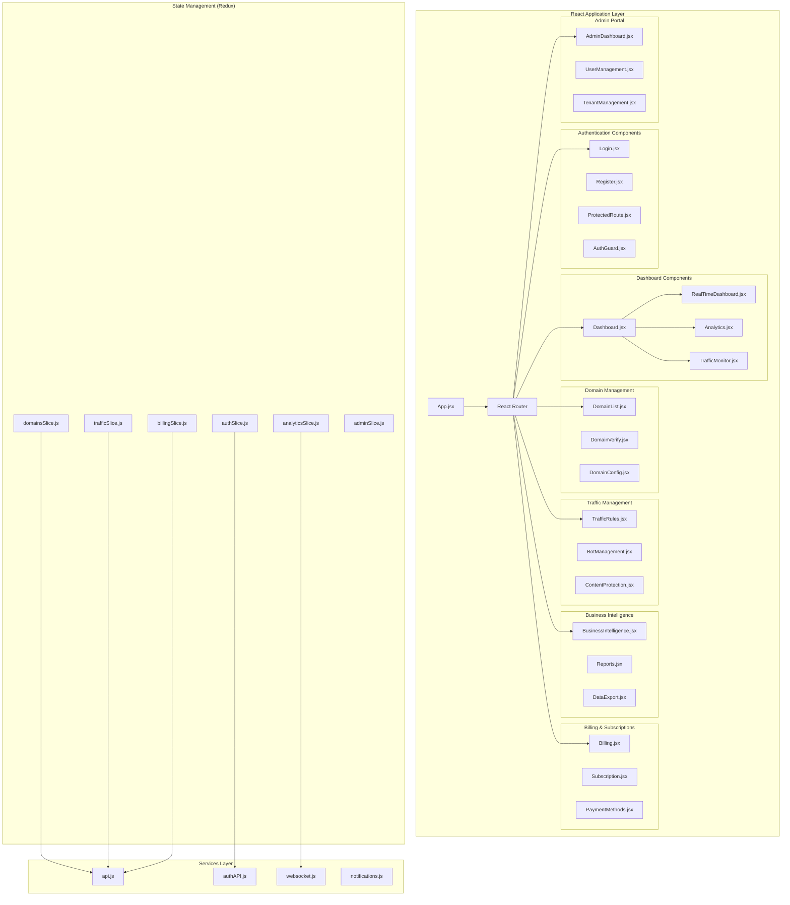

### 2. Backend API Architecture

```mermaid
graph TB
    subgraph "Flask Application Core"
        App[app.py / app_minimal.py]
        Config[config.py]
        Models[models.py]
    end
    
    subgraph "Authentication & Authorization"
        AuthRoutes[auth/routes.py]
        JWTManager[JWT Manager]
        RBAC[Role-Based Access Control]
        APIKeyMgmt[API Key Management]
    end
    
    subgraph "API Endpoints Layer"
        AdminAPI[api/admin.py]
        AnalyticsAPI[api/analytics.py]
        BillingAPI[api/billing.py]
        SecurityAPI[api/security.py]
        TrafficAPI[api/traffic_interception.py]
        RulesAPI[api/rules.py]
        RealtimeAPI[api/real_time.py]
        WebhookAPI[api/webhook_management.py]
        BIAPI[api/business_intelligence.py]
        ContentAPI[api/content_protection.py]
        NotificationAPI[api/notifications.py]
        PerformanceAPI[api/performance.py]
        ReportAPI[api/reporting.py]
        MLManagementAPI[api/ml_management.py]
        EdgeAPI[api/edge_computing.py]
        WhiteLabelAPI[api/white_label.py]
        CollabAPI[api/collaboration.py]
        ExportAPI[api/export.py]
        Phase2API[api/phase2_endpoints.py]
    end
    
    subgraph "Core Business Logic"
        TrafficInterceptor[interceptor/traffic_interceptor.py]
        BotClassifier[interceptor/ml_bot_classifier.py]
        ContentProtection[interceptor/content_protection.py]
        DomainVerification[interceptor/domain_verification_enhanced.py]
        BillingService[interceptor/billing_service.py]
        RealTimeProcessor[interceptor/realtime_processor.py]
        TrafficProcessor[interceptor/traffic_processor_enhanced.py]
    end
    
    subgraph "Utilities & Services"
        RateLimiter[utils/rate_limiter.py]
        CacheManager[utils/cache_manager.py]
        AntiScraping[utils/anti_scraping.py]
        DatabaseOptimizer[utils/database_optimizer.py]
        ContentFingerprint[utils/content_fingerprint.py]
        ThreatIntel[security/threat_intelligence.py]
    end
    
    subgraph "ML & Analytics"
        AdvancedMLEngine[ml/advanced_ml_engine.py]
        BotDetectionModel[ml/bot_detection_model.py]
        EnhancedBotDetector[interceptor/enhanced_bot_detector.py]
    end
    
    App --> Config
    App --> Models
    App --> AuthRoutes
    App --> AdminAPI
    App --> TrafficAPI
    
    TrafficAPI --> TrafficInterceptor
    TrafficInterceptor --> BotClassifier
    TrafficInterceptor --> ContentProtection
    BotClassifier --> AdvancedMLEngine
    ContentProtection --> AntiScraping
    
    AuthRoutes --> JWTManager
    AuthRoutes --> RBAC
    
    All APIs --> RateLimiter
    All APIs --> CacheManager
```

### 3. Traffic Processing Pipeline

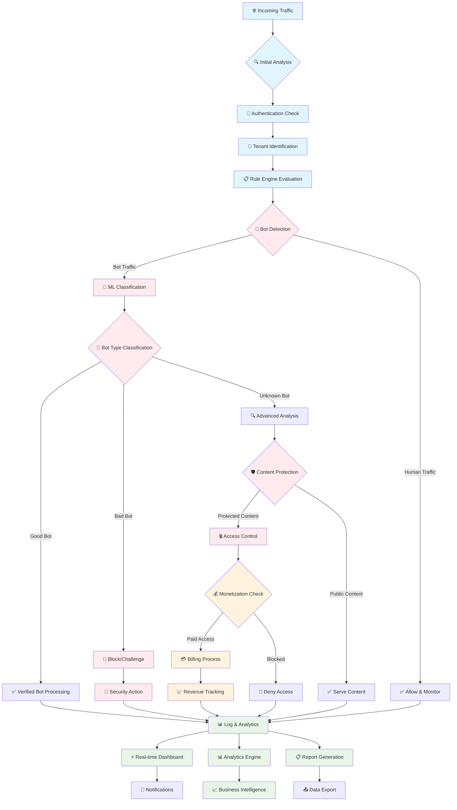

### 4. Domain Verification Flow

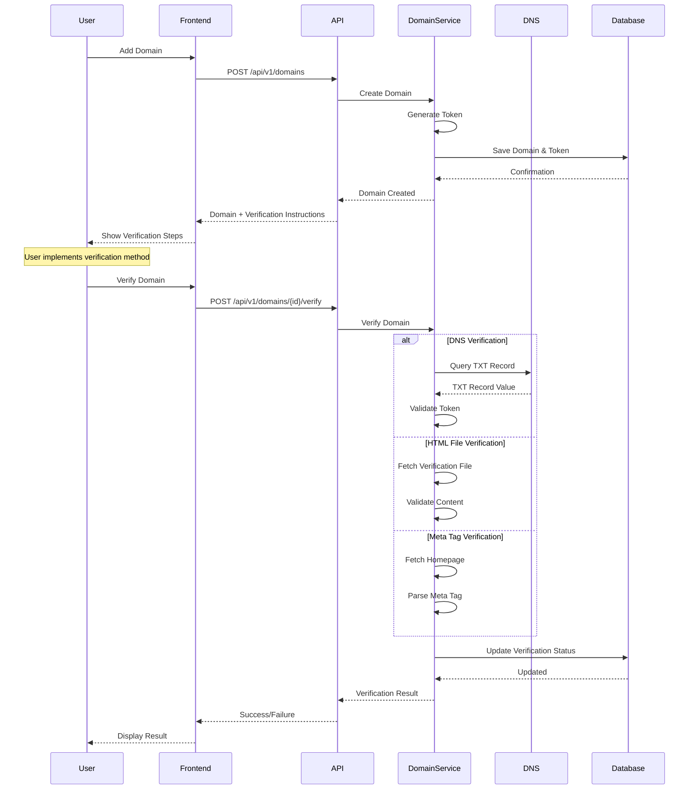

### 5. ML Bot Classification Pipeline

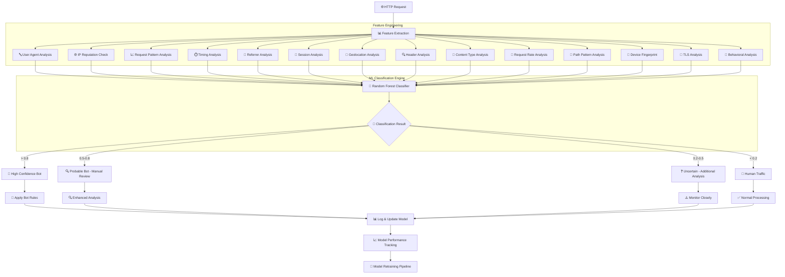

### 6. Billing & Monetization Flow

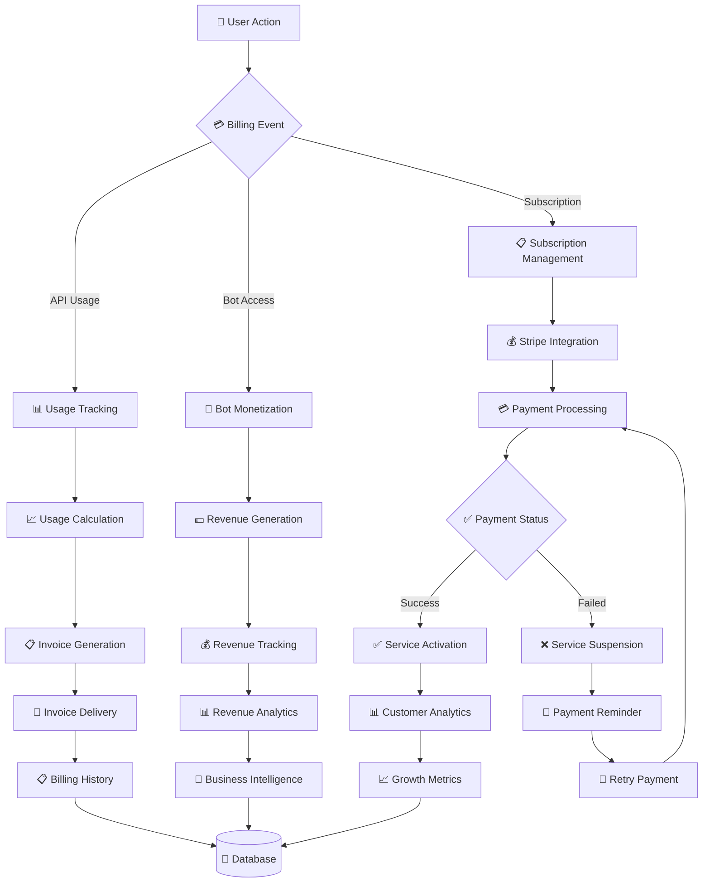

### 7. Real-time Analytics Pipeline

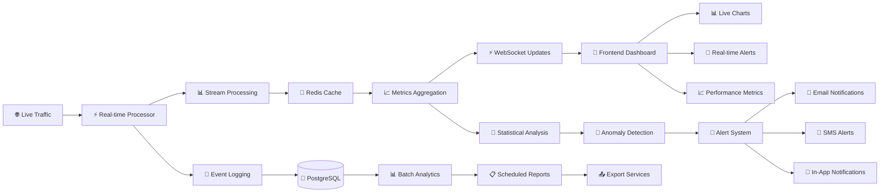

## Data Flow Diagrams

### 1. User Authentication Flow

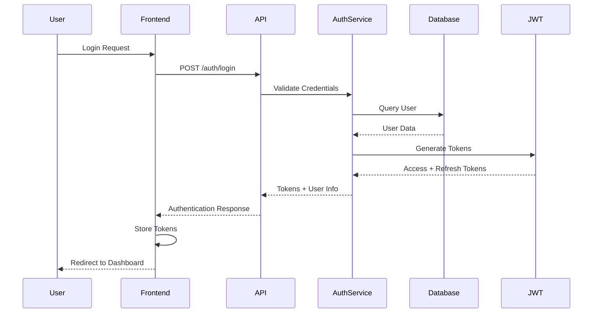

### 2. Domain Management Flow

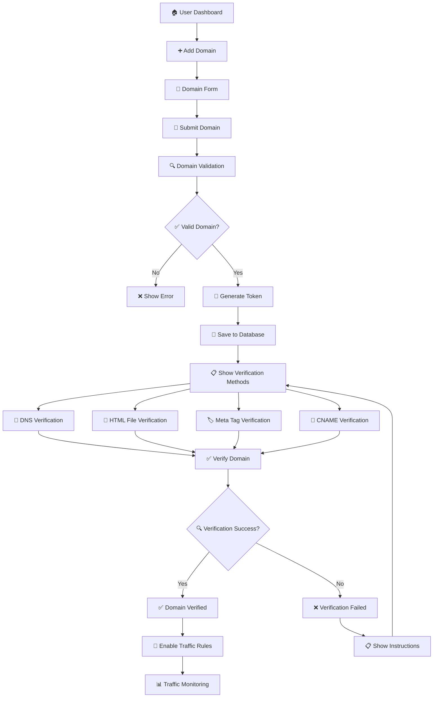

### 3. Traffic Interception Flow

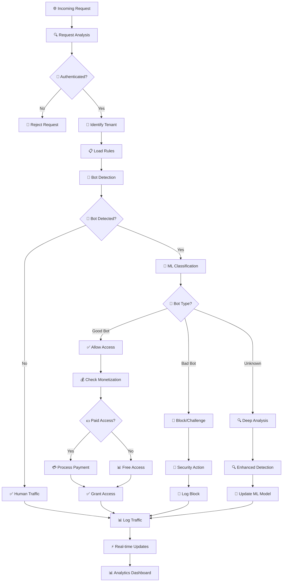

## Security Architecture

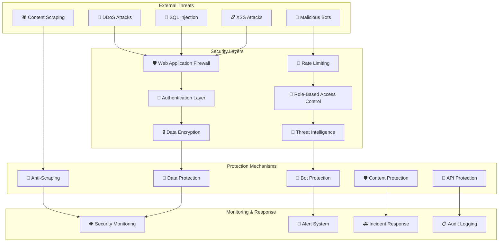

## Performance & Scalability Architecture

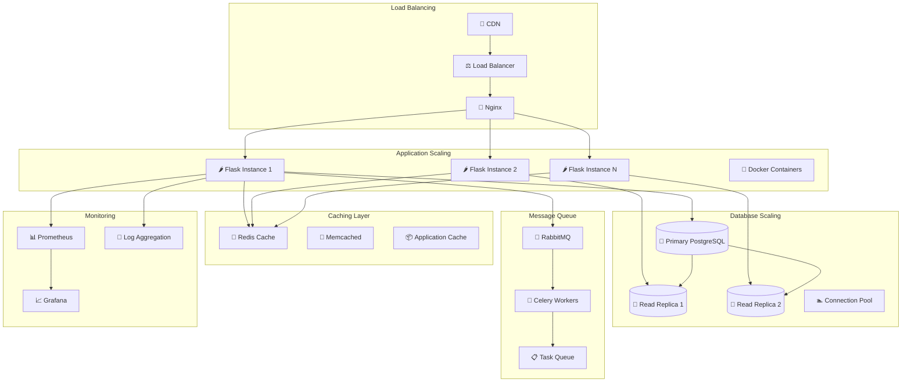

## Database Schema Overview

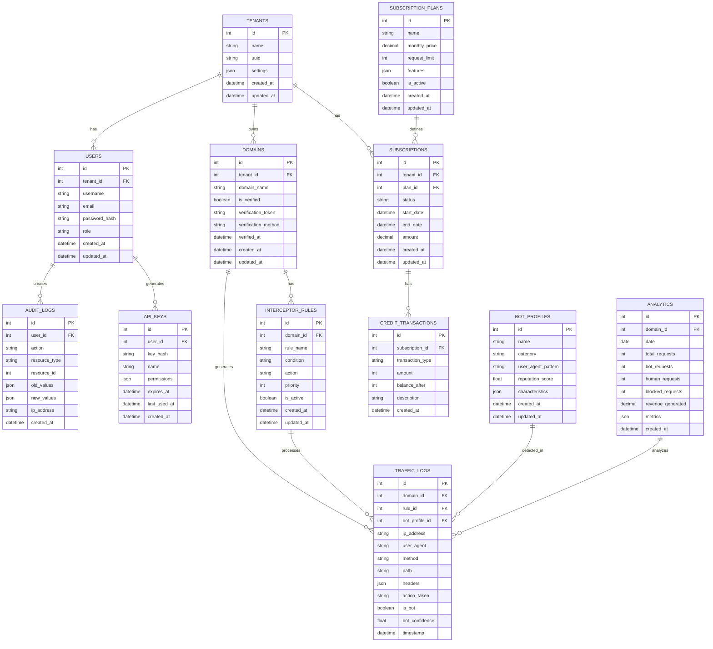

## Technology Stack Summary

### Frontend Technologies
- **React 18** - Modern UI framework
- **Redux Toolkit** - State management
- **React Router** - Client-side routing
- **TailwindCSS** - Utility-first styling
- **Vite** - Build tool and dev server
- **Axios** - HTTP client
- **Chart.js/Recharts** - Data visualization
- **React Hook Form** - Form handling
- **React Query** - Server state management

### Backend Technologies
- **Python Flask** - Web framework
- **SQLAlchemy** - ORM
- **PostgreSQL** - Primary database
- **Redis** - Caching and sessions
- **Celery** - Background task processing
- **JWT** - Authentication tokens
- **Stripe** - Payment processing
- **Flask-CORS** - Cross-origin requests
- **Flask-Migrate** - Database migrations
- **Marshmallow** - Serialization

### Machine Learning & Analytics
- **Scikit-learn** - ML algorithms
- **Pandas** - Data manipulation
- **NumPy** - Numerical computing
- **Joblib** - Model persistence
- **Random Forest** - Bot classification
- **Feature Engineering** - Custom extractors

### DevOps & Infrastructure
- **Docker** - Containerization
- **Docker Compose** - Multi-container orchestration
- **Nginx** - Reverse proxy and load balancer
- **Gunicorn** - WSGI server
- **Prometheus** - Metrics collection
- **Grafana** - Monitoring dashboards
- **GitLab CI/CD** - Continuous integration

### Security & Monitoring
- **Flask-Security** - Authentication & authorization
- **Rate limiting** - DDoS protection
- **CSRF protection** - Cross-site request forgery
- **SQL injection prevention** - Parameterized queries
- **XSS protection** - Input sanitization
- **Audit logging** - Security events tracking

## Deployment Architecture

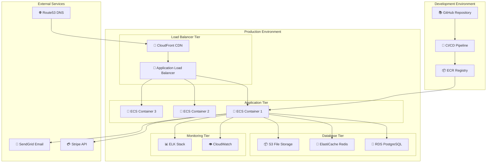

---

## Summary

This comprehensive architecture flow documentation covers all major components and features of the Traffic Interceptor SaaS Platform:

### 🎯 **Core Features Covered:**
1. **Traffic Interception & Bot Detection**
2. **Multi-tenant Architecture**
3. **Domain Verification System**
4. **Real-time Analytics & Monitoring**
5. **Billing & Monetization**
6. **Content Protection**
7. **Security & Threat Intelligence**
8. **Admin & User Management**
9. **API Management**
10. **Performance & Scalability**

### 📊 **Architecture Benefits:**
- **Scalable**: Microservices-based design
- **Secure**: Multi-layer security implementation
- **Performant**: Caching and optimization strategies
- **Maintainable**: Clear separation of concerns
- **Extensible**: Modular component architecture
- **Production-Ready**: Enterprise-grade reliability

This architecture supports the platform's mission to provide enterprise-grade bot traffic management with advanced analytics, content protection, and revenue optimization capabilities.

**Created**: August 26, 2025  
**Version**: 1.0.0  
**Status**: Production Architecture  
**Platform**: Traffic Interceptor SaaS v2.0+
