# Traffic Interceptor - Domains + Rules + Traffic Interception Architecture

## System Architecture Overview

This Mermaid diagram represents the hierarchical architecture of the Traffic Interceptor SaaS Platform, showing the Domains + Rules + Traffic Interception features with clear frontend and backend separation.

```mermaid
graph TB
    %% Styling
    classDef frontend fill:#E3F2FD,stroke:#1976D2,stroke-width:2px,color:#0D47A1
    classDef backend fill:#F3E5F5,stroke:#7B1FA2,stroke-width:2px,color:#4A148C
    classDef data fill:#E8F5E8,stroke:#388E3C,stroke-width:2px,color:#1B5E20
    classDef external fill:#FFF3E0,stroke:#F57C00,stroke-width:2px,color:#E65100
    classDef gateway fill:#FCE4EC,stroke:#C2185B,stroke-width:2px,color:#880E4F

    %% Title
    subgraph Title ["🚀 Traffic Interceptor SaaS Platform - Domains + Rules + Traffic Interception Architecture"]
        direction TB
    end

    %% Frontend Layer
    subgraph Frontend ["🎨 Frontend Layer"]
        subgraph Dashboard ["📊 Core Dashboard"]
            DashboardMain["Dashboard Overview"]
            RTMetrics["Real-time Metrics"]
            KPICards["KPI Cards"]
            QuickActions["Quick Actions"]
            WelcomeBanner["Welcome Banner"]
            
            AnalyticsMain["Analytics Dashboard"]
            TabNav["6-Tab Navigation"]
            OverviewTab["Overview Tab"]
            TrafficTab["Traffic Analysis Tab"]
            BotTab["Bot Intelligence Tab"]
            RevenueTab["Revenue Analytics Tab"]
            GeoTab["Geographic Data Tab"]
            RealTimeTab["Real-time Tab"]
            
            Charts["Advanced Charts"]
            LineCharts["Line Charts"]
            BarCharts["Bar Charts"]
            PieCharts["Pie Charts"]
            AreaCharts["Area Charts"]
            GeoMaps["Geographic Maps"]
            
            DataExport["Data Export"]
        end
        
        subgraph DomainFrontend ["🌐 Domain Management"]
            DomainMain["Domain Dashboard"]
            DomainList["Domain List View"]
            DomainDetails["Domain Details"]
            DomainStats["Domain Statistics"]
            DomainActions["Domain Actions"]
            
            DomainOps["Domain Operations"]
            AddDomain["Add Domain Form"]
            EditDomain["Edit Domain Form"]
            DomainVerify["Domain Verification"]
            DomainConfig["Domain Configuration"]
            
            DomainMonitoring["Domain Monitoring"]
            HealthMonitor["Health Monitoring"]
            SSLStatus["SSL Certificate Status"]
            CDNConfig["CDN Configuration"]
            TrafficSettings["Traffic Settings"]
        end
        
        subgraph RulesFrontend ["⚙️ Rules Engine Frontend"]
            RulesMain["Rules Dashboard"]
            RulesList["Rules List View"]
            RuleStats["Rule Statistics"]
            RuleManagement["Rule Management"]
            RuleTesting["Rule Testing"]
            
            RuleBuilder["Rule Builder"]
            RuleForm["Rule Form"]
            ConditionBuilder["Condition Builder"]
            ActionBuilder["Action Builder"]
            RuleTemplates["Rule Templates"]
            
            RuleTypes["Rule Types"]
            BotRules["Bot Detection Rules"]
            RateRules["Rate Limiting Rules"]
            GeoRules["Geo-blocking Rules"]
            ContentRules["Content Protection Rules"]
            WhitelistRules["Whitelist Rules"]
            BlacklistRules["Blacklist Rules"]
        end
        
        subgraph TrafficFrontend ["🛡️ Traffic Interception Frontend"]
            TrafficMain["Traffic Dashboard"]
            LiveTraffic["Live Traffic Feed"]
            TrafficMetrics["Traffic Metrics"]
            TrafficAlerts["Real-time Alerts"]
            PerfMonitor["Performance Monitoring"]
            
            TrafficOps["Traffic Operations"]
            TrafficProcessing["Traffic Processing"]
            BotDetection["Bot Detection Display"]
            ThreatAnalysis["Threat Analysis"]
            ResponseActions["Response Actions"]
            
            TrafficAnalytics["Traffic Analytics"]
            TrafficPatterns["Traffic Patterns"]
            GeoDistribution["Geographic Distribution"]
            BotClassification["Bot Classification"]
            SecurityMetrics["Security Metrics"]
        end
    end

    %% Backend Layer
    subgraph Backend ["⚙️ Backend Layer"]
        subgraph APIGateway ["🚪 API Gateway"]
            AuthService["Authentication Service"]
            RateLimit["Rate Limiting"]
            RequestRouting["Request Routing"]
            ResponseCache["Response Caching"]
        end
        
        subgraph DomainBackend ["🌐 Domain Management Backend"]
            DomainService["Domain Service"]
            DomainCRUD["Domain CRUD Operations"]
            DomainValidation["Domain Validation"]
            DomainVerifyEngine["Domain Verification Engine"]
            DomainHealth["Domain Health Monitoring"]
            
            DomainVerification["Domain Verification"]
            DNSVerify["DNS Verification"]
            SSLCheck["SSL Certificate Check"]
            OwnershipCheck["Domain Ownership Validation"]
            TokenMgmt["Verification Token Management"]
            
            DomainConfigBackend["Domain Configuration"]
            SSLMgmt["SSL Management"]
            CDNMgmt["CDN Configuration"]
            TrafficSettingsBackend["Traffic Settings"]
            MonitoringConfig["Monitoring Configuration"]
        end
        
        subgraph RulesBackend ["⚙️ Rules Engine Backend"]
            RulesService["Rules Service"]
            RuleCRUD["Rule CRUD Operations"]
            RuleValidation["Rule Validation"]
            RulePriority["Rule Priority Management"]
            RuleTestingBackend["Rule Testing Framework"]
            
            RuleEngine["Rule Processing Engine"]
            ConditionEvaluator["Condition Evaluator"]
            ActionExecutor["Action Executor"]
            RuleChaining["Rule Chaining"]
            RuleCache["Rule Caching"]
            
            RuleTemplatesBackend["Rule Templates"]
            BotTemplates["Bot Detection Templates"]
            RateTemplates["Rate Limiting Templates"]
            SecurityTemplates["Security Templates"]
            CustomBuilder["Custom Rule Builder"]
        end
        
        subgraph TrafficBackend ["🛡️ Traffic Interception Backend"]
            TrafficInterceptor["Traffic Interceptor"]
            RequestIntercept["Request Interception"]
            BotDetectionEngine["Bot Detection Engine"]
            GeoAnalysis["Geographic Analysis"]
            ThreatDetection["Threat Detection"]
            
            TrafficProcessor["Traffic Processor"]
            RequestProcessing["Request Processing"]
            ResponseGeneration["Response Generation"]
            PerfMonitoring["Performance Monitoring"]
            ErrorHandling["Error Handling"]
            
            TrafficAnalyticsBackend["Traffic Analytics"]
            TrafficLogging["Traffic Logging"]
            AnalyticsCalc["Analytics Calculation"]
            RealTimeMetrics["Real-time Metrics"]
            DataAggregation["Data Aggregation"]
        end
        
        subgraph DataLayer ["💾 Data Layer"]
            DBModels["Database Models"]
            DomainModel["Domain Model"]
            RuleModel["Rule Model"]
            TrafficLogModel["Traffic Log Model"]
            UserModel["User Model"]
            TenantModel["Tenant Model"]
            
            CacheLayer["Cache Layer"]
            RedisCache["Redis Cache"]
            RuleCacheBackend["Rule Cache"]
            SessionCache["Session Cache"]
            AnalyticsCache["Analytics Cache"]
        end
    end

    %% External Services
    subgraph External ["🌍 External Services"]
        DNSServices["DNS Services"]
        SSLCA["SSL Certificate Authorities"]
        CDNProviders["CDN Providers"]
        GeoIPServices["GeoIP Services"]
        BotAPIs["Bot Intelligence APIs"]
    end

    %% Frontend Dependencies
    DashboardMain -.-> AnalyticsMain
    DomainMain -.-> DomainOps
    DomainMain -.-> DomainMonitoring
    RulesMain -.-> RuleBuilder
    RulesMain -.-> RuleTypes
    TrafficMain -.-> TrafficOps
    TrafficMain -.-> TrafficAnalytics

    %% Backend Dependencies
    APIGateway -.-> DomainBackend
    APIGateway -.-> RulesBackend
    APIGateway -.-> TrafficBackend
    DomainBackend -.-> DataLayer
    RulesBackend -.-> DataLayer
    TrafficBackend -.-> DataLayer

    %% Frontend to Backend Dependencies
    DashboardMain -.-> APIGateway
    AnalyticsMain -.-> APIGateway
    DomainFrontend -.-> DomainBackend
    RulesFrontend -.-> RulesBackend
    TrafficFrontend -.-> TrafficBackend

    %% External Service Dependencies
    DomainBackend -.-> External
    TrafficBackend -.-> External

    %% Data Flow Dependencies
    TrafficBackend -.-> RulesBackend
    RulesBackend -.-> DomainBackend
    DomainBackend -.-> TrafficBackend

    %% Cross-cutting Dependencies
    AuthService -.-> DataLayer
    RateLimit -.-> CacheLayer
    ResponseCache -.-> CacheLayer

    %% Apply Styling
    class Frontend,Dashboard,DomainFrontend,RulesFrontend,TrafficFrontend frontend
    class Backend,APIGateway,DomainBackend,RulesBackend,TrafficBackend backend
    class DataLayer data
    class External external
    class APIGateway gateway
```

## Architecture Features

### 🎯 **Frontend Layer**
- **Core Dashboard**: Real-time metrics, KPI cards, quick actions
- **Domain Management**: Domain CRUD, verification, monitoring
- **Rules Engine**: Rule builder, templates, management
- **Traffic Interception**: Live monitoring, analytics, operations

### ⚙️ **Backend Layer**
- **API Gateway**: Authentication, rate limiting, routing, caching
- **Domain Management**: CRUD operations, verification, configuration
- **Rules Engine**: Processing engine, templates, validation
- **Traffic Interception**: Interceptor, processor, analytics
- **Data Layer**: Database models, caching layer

### 🌍 **External Services**
- DNS services, SSL authorities, CDN providers
- GeoIP services, bot intelligence APIs

### 🔗 **Dependencies**
- **Dashed arrows** show component dependencies
- **Frontend to Backend** communication paths
- **Cross-cutting concerns** (auth, caching, rate limiting)
- **Data flow** between traffic, rules, and domains

## Usage

This Mermaid diagram can be rendered in:
- GitHub Markdown files
- GitLab documentation
- Notion pages
- Mermaid Live Editor
- VS Code with Mermaid extension
- Any platform supporting Mermaid syntax

The diagram maintains the same hierarchical structure as the PlantUML version while using Mermaid's graph syntax and styling capabilities.

