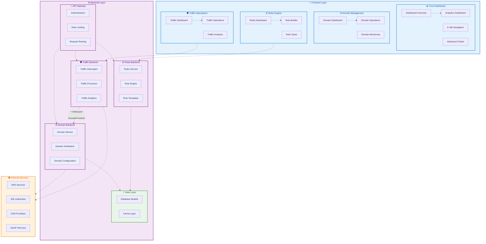

# Traffic Interceptor - Mermaid Architecture Diagram

## System Architecture Overview

This Mermaid diagram represents the hierarchical architecture of the Traffic Interceptor SaaS Platform.

## Features

- **Frontend Layer**: Dashboard, Domain Management, Rules Engine, Traffic Interception
- **Backend Layer**: API Gateway, Services, Data Layer
- **External Services**: DNS, SSL, CDN, GeoIP
- **Dependencies**: Dashed arrows showing relationships
